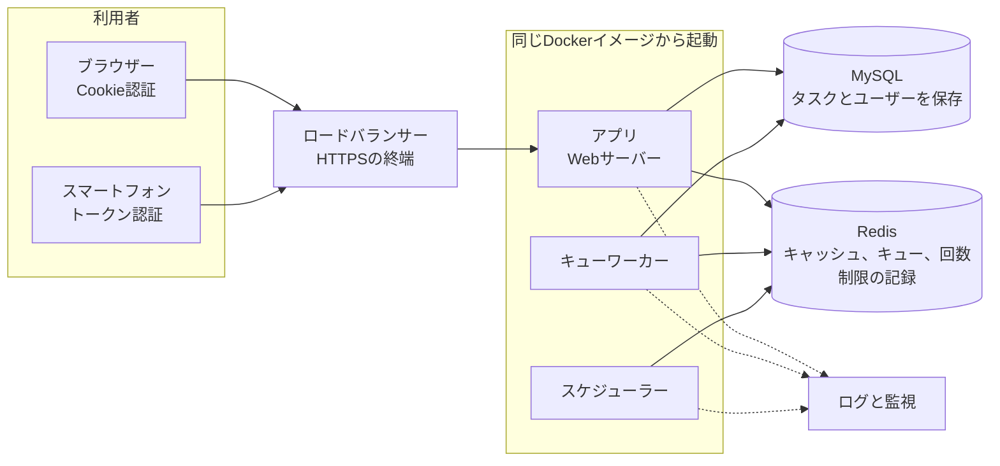

# 第17章 運用

APIは公開してからが本番です。この章では、本番環境で何が起きているかを知るためのログと監視、速さを保つためのキャッシュとキュー、そして本番用のDockerイメージとデプロイの手順を学びます。

## この章のゴール

- ログとリクエストIDで、1つのリクエストの流れを追える
- キャッシュとキューで、APIの応答を速く保てる
- 本番用のイメージを作り、デプロイの手順を説明できる

## 17.1 本番環境の構成

本書のAPIを本番で動かすときの基本的な構成は、次の部品からなります。



利用者（ブラウザーとスマートフォン）のリクエストは、HTTPSを終端するロードバランサーを経てアプリに届きます。アプリ、キューワーカー、スケジューラーは同じイメージから起動し、同じMySQLとRedisを使います。ログはすべてのコンテナーから集め、監視の仕組みで見張ります。

| 部品 | 役割 |
| --- | --- |
| ロードバランサー | HTTPSの終端。複数のアプリサーバーにリクエストを振り分ける |
| アプリ（Webサーバー） | Laravelが動き、APIのリクエストを処理する。負荷に応じて台数を増やす |
| キューワーカー | メール送信などの時間のかかる処理を、裏側で順番に実行する |
| スケジューラー | 決まった時刻に処理を実行する（期限切れトークンの削除など） |
| データベース（MySQL） | タスクやユーザーのデータを保存する |
| Redis | キャッシュ、回数制限の記録、キューの待ち行列を、全サーバーで共有する |
| ログと監視の仕組み | ログを集めて検索し、異常があれば知らせる |

アプリ、キューワーカー、スケジューラーは、同じDockerイメージから起動し、実行するコマンドだけを変えます。

## 17.2 ログの基本

ログは、アプリの中で起きたことの記録です。障害が起きたとき、原因を探す最大の手がかりになります。

```php
use Illuminate\Support\Facades\Log;

Log::info('タスクを作成しました', ['task_id' => $task->id, 'user_id' => $user->id]);
Log::warning('外部サービスの応答が遅い', ['elapsed_ms' => 2300]);
Log::error('メールを送れませんでした', ['exception' => $e]);
```

第2引数の配列は「コンテキスト」と呼ばれる付加情報です。文章の中に値を埋め込むより、コンテキストに分けて書くほうが、後で検索や集計がしやすくなります。

| レベル | 使う場面 |
| --- | --- |
| debug | 開発中の詳細な情報。本番では通常出さない |
| info | 正常な処理の記録（ログイン、作成など） |
| warning | 処理は続けられるが注意が必要なこと |
| error | 処理が失敗したこと。対応が必要 |
| critical 以上 | サービス全体に関わる重大な問題 |

`.env` の `LOG_LEVEL` で、記録する最低レベルを決めます。本番では info か warning にするのが一般的です。

開発中は、Laravelに付属する Pail でログをリアルタイムに見られます。

```bash
$ sail artisan pail
$ sail artisan pail --level=error   # エラーだけを表示する
```

## 17.3 リクエストIDでログをつなぐ

本番では、多数のリクエストのログが混ざって記録されます。1つのリクエストに関するログを後から集められるように、リクエストごとにIDを付けます。

```bash
$ sail artisan make:middleware AssignRequestId
```

```php
<?php

namespace App\Http\Middleware;

use Closure;
use Illuminate\Http\Request;
use Illuminate\Support\Facades\Context;
use Illuminate\Support\Str;
use Symfony\Component\HttpFoundation\Response;

class AssignRequestId
{
    public function handle(Request $request, Closure $next): Response
    {
        // 前段のサーバーがIDを付けていればそれを使い、なければ新しく作る
        $requestId = $request->header('X-Request-Id') ?: (string) Str::uuid();

        // Contextに入れた値は、このリクエスト中のすべてのログに自動で付く
        Context::add('request_id', $requestId);

        $response = $next($request);
        $response->headers->set('X-Request-Id', $requestId);

        return $response;
    }
}
```

このミドルウェアも `bootstrap/app.php` の `$middleware->api(prepend: [...])` に追加します。利用者から「エラーが出た」と問い合わせがあったとき、応答ヘッダーの X-Request-Id を教えてもらえば、該当するログをすぐに探せます。

ログイン後のリクエストでは、ユーザーIDもコンテキストに加えておくと調査に便利です。ただし、パスワード、トークン、メールアドレスのような個人情報や秘密情報は、ログに出さないように注意します。

## 17.4 コンテナーでのログの出し方

Dockerで動かす場合、ログはファイルではなく標準エラー出力に書き出すのが基本です。コンテナーの外の仕組み（クラウドのログサービスなど）が、出力をまとめて収集してくれます。本番の `.env` では次のように設定します。

```dotenv
LOG_CHANNEL=stderr
LOG_LEVEL=info
LOG_STDERR_FORMATTER=Monolog\Formatter\JsonFormatter
```

最後の行で、ログを1行1件のJSON形式で出力します。ログ収集の仕組みが項目ごとに解析できるので、「request\_id がこの値のログ」「レベルが error のログ」といった検索が簡単になります。

> 設計判断メモ：ログは標準エラー出力にJSONで出す
>
> 決めたこと：本番では、ログを標準エラー出力に、1行1件のJSONで書き出す。
>
> 選ばなかった案：storage/logs のファイルに書き出す方法。コンテナーを作り直すとファイルが消え、サーバーの台数が増えると各サーバーのファイルを集めるのも大変になる。
>
> 理由：コンテナーの外の仕組みが、全サーバーのログをまとめて集め、検索できるようにしてくれる。JSONなら項目ごとに検索や集計ができる。
>
> 見直す条件：コンテナーを使わない従来のサーバー構成では、ファイルへの出力と、ログを転送するツールを組み合わせる。

## 17.5 監視

監視は、APIが正しく動いているかを常に見張り、異常があれば知らせる仕組みです。

死活監視には、第4章で触れた /up を使います。アプリが起動していれば200を返すので、ロードバランサーや監視サービスから定期的に呼び出し、応答がなければアラートを出します。

死活監視だけでは「動いているが遅い」「一部のAPIだけエラーが多い」といった問題に気づけません。次の数値も見張ります。

| 指標 | 見る理由 |
| --- | --- |
| 5xxエラーの割合 | サーバー側の不具合の発生 |
| 応答時間（95パーセンタイル） | 遅い応答を受けている利用者の割合 |
| 429の数 | 攻撃の兆候、または制限が厳しすぎる |
| キューに残っている件数 | ワーカーが処理に追いついているか |
| 遅いSQL | データベースが遅さの原因になっていないか |

Laravelには、こうした情報を集めるための公式ツールがあります。開発中の詳しい調査にはTelescope、本番のダッシュボードにはPulse、Laravelが提供する監視サービスにはNightwatchがあります。規模や予算に合わせて選んでください。

遅いSQLは、自分でログに出すこともできます。`AppServiceProvider` の `boot()` に追加します。

```php
use Illuminate\Database\Events\QueryExecuted;
use Illuminate\Support\Facades\DB;
use Illuminate\Support\Facades\Log;

DB::listen(function (QueryExecuted $query) {
    if ($query->time > 200) {   // 200ミリ秒を超えたSQLを記録する
        Log::warning('遅いSQL', ['sql' => $query->sql, 'time_ms' => $query->time]);
    }
});
```

## 17.6 キャッシュ

キャッシュは、一度作った結果を一時的に保存して使い回す仕組みです。データベースへの問い合わせを減らし、応答を速くします。本番では、全サーバーで共有できるRedisを使います。

```dotenv
CACHE_STORE=redis
```

タグの一覧は変更が少ないので、ユーザーごとに10分間キャッシュしてみます。

```php
use Illuminate\Support\Facades\Cache;

public function index(Request $request): AnonymousResourceCollection
{
    $user = $request->user();

    $tags = Cache::remember("users:{$user->id}:tags", now()->addMinutes(10),
        fn () => $user->tags()->orderBy('name')->get());

    return TagResource::collection($tags);
}
```

`Cache::remember` は、キャッシュがあればそれを返し、なければ関数を実行して結果を保存してから返します。

キャッシュで大切なのは、元のデータが変わったときに古いキャッシュを消すことです。タスクのタグを付け替えると新しいタグが作られることがあるので、TaskController の `syncTags` の最後でキャッシュを消します。

```php
// トランザクションが確定した後で消す（確定前に消すと、古い値がまたキャッシュされることがある）
DB::afterCommit(fn () => Cache::forget("users:{$user->id}:tags"));
```

syncTags はトランザクションの中で呼ばれるので、そのまま消すと、確定する前に別のリクエストが古いタグを読み、それを再びキャッシュしてしまうことがあります。`DB::afterCommit` を使うと、トランザクションが確定した後に消せます。それでも、ごくまれに古い値が残る可能性はあります。タグの一覧は少し古くても困らないデータなので、最長10分の古さを許してキャッシュしています。常に最新でなければ困るデータなら、キャッシュしないのも立派な判断です。

キャッシュのキーにユーザーIDを含めているのは、他人のタグ一覧が混ざらないようにするためです。キーの付け方を誤ると、別の利用者のデータを返してしまう深刻な事故になります。

## 17.7 キューで重い処理を後回しにする

メールの送信や外部サービスの呼び出しのように時間のかかる処理を、APIのリクエストの中で行うと、応答が遅くなります。キューを使うと、処理を「ジョブ」として待ち行列に入れ、裏側のワーカーに任せられます。APIはすぐに応答を返せます。

例として、翌日が期限のタスクを知らせるメールを送るジョブを作ります。

```bash
$ sail artisan make:job SendDueTaskReminder
```

```php
<?php

namespace App\Jobs;

use App\Models\Task;
use App\Models\User;
use Illuminate\Contracts\Queue\ShouldQueue;
use Illuminate\Foundation\Queue\Queueable;
use Illuminate\Support\Collection;
use Illuminate\Support\Facades\Mail;

class SendDueTaskReminder implements ShouldQueue
{
    use Queueable;

    public int $tries = 3;   // 失敗したら3回まで再試行する

    // 対象の日付（YYYY-MM-DD）は、ジョブを登録するときに日本時間で決めて渡す
    public function __construct(public User $user, public string $date)
    {
    }

    // 通知してよいタスクだけを選ぶ。テストしやすいようにメソッドに分ける
    public function targetTasks(): Collection
    {
        $teamIds = $this->user->teams()->pluck('teams.id');   // 今も所属しているチーム

        return Task::query()
            ->where('is_done', false)
            ->whereDate('due_date', $this->date)
            ->where(function ($query) use ($teamIds) {
                // 自分の個人のタスク
                $query->where(fn ($q) => $q->where('user_id', $this->user->id)->whereNull('team_id'))
                    // 今も所属しているチームで、自分が担当のタスク
                    ->orWhere(fn ($q) => $q->where('assignee_id', $this->user->id)->whereIn('team_id', $teamIds));
            })
            ->get();
    }

    public function handle(): void
    {
        $titles = $this->targetTasks()->pluck('title');

        if ($titles->isEmpty()) {
            return;
        }

        Mail::raw("明日が期限のタスク：\n".$titles->implode("\n"), function ($message) {
            $message->to($this->user->email)->subject('明日が期限のタスクがあります');
        });
    }
}
```

通知の対象は、自分の個人のタスクと、今も所属しているチームで自分が担当のタスクに限っています。`$this->user->tasks()` のように「自分が作ったタスク」をそのまま使うと、チームから外れた後も、そのチームのタスクの内容がメールで届いてしまいます。APIのPolicyで閲覧を禁じていても、通知のような別の経路から情報が漏れることがあるので注意が必要です。この点は、次のようなテストで確かめておきます。

```php
public function test_reminder_excludes_tasks_of_a_team_the_user_left(): void
{
    $user = User::factory()->create();
    $team = Team::factory()->create();
    $team->members()->attach($user->id, ['role' => TeamRole::Member->value]);
    Task::factory()->for($team)->for($user)->create(['due_date' => '2026-11-04', 'assignee_id' => $user->id]);

    $team->members()->detach($user->id);   // チームから外す

    $job = new SendDueTaskReminder($user, '2026-11-04');
    $this->assertCount(0, $job->targetTasks());
}
```

対象の日付を引数で受け取っているのは、タイムゾーンのずれを防ぐためです。Laravelの標準のタイムゾーンはUTCです。日本時間の朝8時はUTCではまだ前日の23時なので、ジョブの中で `today()->addDay()` と書くと、日本時間の「明日」ではなく「今日」になってしまいます。日付は日本時間で決めてから渡します。

ジョブを待ち行列に入れるには `dispatch` を使います。

```php
SendDueTaskReminder::dispatch($user, now('Asia/Tokyo')->addDay()->toDateString());
```

待ち行列にもRedisを使い、ワーカーを起動します。開発環境ではメールは実際には送られず、ログに書き出されます（MAIL\_MAILER=log）。

```dotenv
QUEUE_CONNECTION=redis
```

```bash
$ sail artisan queue:work
```

本番では、ワーカーは常に動かし続け、止まったら自動で再起動するようにします。新しいコードをデプロイしたときは、ワーカーも再起動しないと古いコードのまま動き続けるので注意してください。

## 17.8 定期実行（スケジューラー）

決まった時刻に実行したい処理は、`routes/console.php` に書きます。

```php
<?php

use App\Jobs\SendDueTaskReminder;
use App\Models\User;
use Illuminate\Support\Facades\Schedule;

// 期限切れから24時間たったトークンを毎日削除する（第10章）
Schedule::command('sanctum:prune-expired --hours=24')->daily();

// 毎朝8時（日本時間）に、全ユーザーのリマインダーをキューに入れる
Schedule::call(function () {
    // アプリの標準のタイムゾーンはUTCなので、「明日」は日本時間で決めて渡す
    $tomorrow = now('Asia/Tokyo')->addDay()->toDateString();

    User::query()->each(fn (User $user) => SendDueTaskReminder::dispatch($user, $tomorrow));
})->dailyAt('08:00')->timezone('Asia/Tokyo');
```

開発中は次のコマンドでスケジューラーを動かせます。本番では、このコマンドを専用のコンテナーで動かすか、cronで毎分 `php artisan schedule:run` を実行します。

```bash
$ sail artisan schedule:work
```

## 17.9 性能を保つ

これまでの章で取り入れた工夫を含め、APIの速さを保つための主な手段をまとめます。

| 手段 | 内容 | 本書 |
| --- | --- | --- |
| N+1問題の防止 | with で関連データをまとめて読み込む | 第7章、第8章 |
| インデックス | よく絞り込む列に索引を付ける | 第7章 |
| ページング | 一覧の件数に上限を設ける | 第8章 |
| キャッシュ | 変化の少ないデータを使い回す | 本章 |
| キュー | 重い処理を応答の外に出す | 本章 |
| 設定のキャッシュ | 設定やルートの読み込みを事前にまとめる | 本章（17.10） |
| OPcache | PHPのコードを解析した結果をメモリーに保存する | 本章（17.10） |

速さを改善するときは、思い込みで手を付けず、まず計測します。遅いSQLのログや監視ツールで、どこに時間がかかっているかを確かめてから改善しましょう。

## 17.10 本番用のDockerイメージ

Sailは開発用の環境なので、本番には使いません。本番用には、必要なものだけを入れた小さく安全なイメージを作ります。プロジェクト直下に `Dockerfile` を作成します。

```dockerfile
# 1段目：依存パッケージをインストールする
FROM composer:2 AS vendor
WORKDIR /app
COPY composer.json composer.lock ./
# PHPの拡張機能は2段目のイメージに入れるので、ここでは確認を省く
RUN composer install --no-dev --no-interaction --prefer-dist \
    --no-scripts --no-autoloader --ignore-platform-reqs
COPY . .
RUN composer dump-autoload --no-dev --optimize --no-scripts

# 2段目：実行用のイメージ
FROM php:8.5-apache

RUN apt-get update \
    && docker-php-ext-install pdo_mysql \
    && pecl install redis && docker-php-ext-enable redis \
    && a2enmod rewrite \
    && rm -rf /var/lib/apt/lists/*

# Apacheの公開フォルダーをLaravelの public に変える
ENV APACHE_DOCUMENT_ROOT=/var/www/html/public
RUN sed -ri -e 's!/var/www/html!${APACHE_DOCUMENT_ROOT}!g' /etc/apache2/sites-available/*.conf \
    && sed -ri -e 's!/var/www/!${APACHE_DOCUMENT_ROOT}!g' /etc/apache2/apache2.conf /etc/apache2/conf-available/*.conf

COPY docker/php.ini /usr/local/etc/php/conf.d/app.ini

WORKDIR /var/www/html
COPY --from=vendor /app /var/www/html

# 本番の依存関係だけで、パッケージの一覧（bootstrap/cache/packages.php）を作り直す
RUN php artisan package:discover
RUN chown -R www-data:www-data storage bootstrap/cache

# 起動のたびに、渡された環境変数で設定のキャッシュを作ってから動かす
COPY docker/entrypoint.sh /usr/local/bin/entrypoint.sh
RUN chmod +x /usr/local/bin/entrypoint.sh
ENTRYPOINT ["entrypoint.sh"]
CMD ["apache2-foreground"]
```

イメージを2段階で作る書き方を、マルチステージビルドと呼びます。1段目で使ったComposerなどの道具は、完成したイメージには含まれません。

`docker/php.ini` には、本番向けのPHPの設定を書きます。

```ini
; コードを解析した結果をメモリーに保存して使い回す
opcache.enable=1
; 本番ではファイルの変更を確認しない（デプロイのたびにコンテナーを作り直すため）
opcache.validate_timestamps=0
opcache.memory_consumption=128
; 応答ヘッダーにPHPのバージョンを出さない
expose_php=Off
```

`docker/entrypoint.sh` は、コンテナーが起動するたびに実行されるスクリプトです。

```sh
#!/bin/sh
set -e

# 必須の環境変数がなければ、起動を止める（第18章）
for name in APP_KEY DB_HOST DB_DATABASE DB_USERNAME DB_PASSWORD REDIS_HOST; do
  if [ -z "$(printenv "$name")" ]; then
    echo "環境変数 $name が設定されていません" >&2
    exit 1
  fi
done

# 環境変数が入った状態で、設定、ルート、イベント、ビューのキャッシュを作る
php artisan optimize

exec "$@"
```

設定などのキャッシュは、それを作ったコンテナーの中にだけ残ります。別のコンテナーで作っても引き継がれないので、Web、キューワーカー、スケジューラーのそれぞれで、起動時に作るようにしています。

`.dockerignore` で bootstrap/cache の中身を除いているのも大切です。開発中の bootstrap/cache には、Sail や Pail のような開発用パッケージの情報を含むファイルが作られます。これを本番のイメージに持ち込むと、本番には入っていないパッケージを読み込もうとして、アプリが起動できなくなることがあります。

イメージに含めたくないファイルは `.dockerignore` に書きます。

```text
.env
.env.*
.git
node_modules
vendor
tests
# 開発環境で作られたキャッシュを持ち込まない
bootstrap/cache/*.php
storage/logs/*
storage/framework/cache/data/*
storage/framework/sessions/*
storage/framework/views/*
```

`.env` を含めないのが重要です。本番の設定値は、イメージの中ではなく、実行するときに環境変数として渡します。こうすると、同じイメージを検証環境と本番環境の両方で使えます。

## 17.11 デプロイの手順

新しいバージョンを本番に出す（デプロイする）ときの基本的な流れは次のとおりです。

1. CI（第13章）でテストが成功したことを確認する
2. Dockerイメージを作り、コンテナーの保管場所（レジストリ）に送る
3. マイグレーションを実行する（`php artisan migrate --force`）
4. 設定、ルート、イベントのキャッシュは、各コンテナーの起動時に entrypoint.sh が作る。手作業での実行は要らない（`php artisan optimize`）
5. 新しいイメージでアプリのコンテナーを順番に入れ替える
6. キューワーカーとスケジューラーも新しいイメージで起動し直す
7. /up と監視の数値で、異常がないことを確認する

1台のサーバーでDockerを使う場合の、手順2から6のコマンドの例です。本番の環境変数は、Gitに含めないファイル（ここでは /srv/taskboard/production.env）にまとめておきます。HTTPSは、前段のロードバランサーやリバースプロキシで終端し、8080番ポートへ転送する前提です。

```bash
# イメージを作る
$ docker build -t taskboard-api:1.4.0 .

# マイグレーションを、一時的なコンテナーで実行する
$ docker run --rm --env-file /srv/taskboard/production.env taskboard-api:1.4.0 \
    php artisan migrate --force

# Web、キューワーカー、スケジューラーを、同じイメージから起動する
$ docker run -d --name taskboard-web --env-file /srv/taskboard/production.env \
    -p 8080:80 taskboard-api:1.4.0
$ docker run -d --name taskboard-worker --env-file /srv/taskboard/production.env \
    taskboard-api:1.4.0 php artisan queue:work --tries=3
$ docker run -d --name taskboard-scheduler --env-file /srv/taskboard/production.env \
    taskboard-api:1.4.0 php artisan schedule:work
```

実際の運用では、古いコンテナーを止めて新しいコンテナーに入れ替える作業や、コンテナーが止まったときの自動の再起動を、コンテナーの実行サービス（AWSやGoogle Cloudのサービスなど）や Docker Compose に任せます。

`php artisan optimize` は、設定ファイルやルートの情報を1つのファイルにまとめ、リクエストごとの読み込みを減らすコマンドです。設定をキャッシュすると、.env ファイルは読み込まれなくなります。そのため、.env にしか書いていない値をコードの中で `env()` で読むと null になります。コンテナーに渡した環境変数は `env()` でも読めますが、設定値は必ず config/ のファイルを経由して `config('app.name')` のように読むよう統一しましょう。

マイグレーションは、古いバージョンのコードが動いている間に実行されます。そのため、列の削除や名前の変更は一度に行わず、「新しい列を追加する、両方に対応したコードをデプロイする、古い列を削除する」のように段階を分けると、止めずに更新できます。

デプロイ先には、AWSやGoogle Cloudなどのコンテナー実行サービスのほか、Laravel公式のLaravel CloudやLaravel Forgeといったサービスもあります。どれを選んでも、本章のイメージ、環境変数、デプロイの流れという考え方は共通です。

> つまずきポイント：本番で環境変数を変えたのに反映されない
>
> 設定をキャッシュしている本番では、環境変数を変えても、キャッシュを作り直すまで古い値が使われます。値を変えたら、`php artisan optimize` をもう一度実行するか、新しい環境変数でコンテナーを起動し直し、起動時にキャッシュを作るようにします。デプロイの手順に「環境変数を変えたときの手順」も書いておきましょう。

## 17.12 APIの寿命を管理する

APIのバージョンを上げたとき（第5章）、古いバージョンを永遠に残すわけにはいきません。古いバージョンの応答に、廃止予定であることを示すヘッダーを付けて、使う側に移行を促します。

```php
// v1 のルートグループに付けるミドルウェアの中で
// 廃止予定であること。値は @ の後にUnix時間で日時を書く（この例は2026-12-31 00:00 UTC）
$response->headers->set('Deprecation', '@1798675200');
$response->headers->set('Sunset', 'Wed, 30 Jun 2027 00:00:00 GMT');   // 提供終了の日時
$response->headers->set('Link', '<https://example.com/docs/v2>; rel="successor-version"');
```

あわせてアクセスログで古いバージョンの利用状況を確認し、利用がなくなったことを確かめてから停止します。

## 17.13 監査ログ

チームで使うサービスでは、「誰が、いつ、何をしたか」を後から確かめたい場面がよくあります。誤って消されたタスクの経緯を調べたり、第18章のようにトークンの漏えいの影響を調べたりするときです。こうした記録を監査ログと呼びます。アプリのログ（17.2節）とは別に、データベースに残します。

```bash
$ sail artisan make:model ActivityLog -m
$ sail artisan make:observer TaskObserver --model=Task
```

マイグレーションの `up` です。

```php
Schema::create('activity_logs', function (Blueprint $table) {
    $table->id();
    // チームを削除しても記録を残すため、外部キーの制約は付けない
    $table->unsignedBigInteger('team_id')->nullable();
    $table->foreignId('user_id')->nullable()->constrained()->nullOnDelete();
    // どのトークンからの操作か。トークンを失効させた後も調べられるよう、IDだけを残す
    $table->unsignedBigInteger('token_id')->nullable();
    $table->string('request_id', 36)->nullable();   // 17.3節のリクエストID
    $table->string('via', 20);             // api、agent、system のどれか
    $table->string('action', 50);          // task.created など
    $table->morphs('subject');             // 操作の対象（subject_type と subject_id）
    $table->json('changes')->nullable();   // 変更された値
    $table->timestamp('created_at')->useCurrent();

    $table->index(['team_id', 'created_at']);
});
```

モデルです。監査ログは記録したら変更しないので、updated\_at は使いません。古い記録は1年で自動的に削除します。

```php
<?php

namespace App\Models;

use Illuminate\Database\Eloquent\Attributes\Fillable;
use Illuminate\Database\Eloquent\Builder;
use Illuminate\Database\Eloquent\MassPrunable;
use Illuminate\Database\Eloquent\Model;
use Illuminate\Database\Eloquent\Relations\BelongsTo;

// 利用者の入力からは作らず、サーバーの処理だけで作るので、team_id なども一括代入を許す
#[Fillable(['team_id', 'user_id', 'token_id', 'request_id', 'via', 'action', 'subject_type', 'subject_id', 'changes'])]
class ActivityLog extends Model
{
    use MassPrunable;

    public const UPDATED_AT = null;

    protected function casts(): array
    {
        return ['changes' => 'array'];
    }

    public function user(): BelongsTo
    {
        return $this->belongsTo(User::class);
    }

    public function prunable(): Builder
    {
        return static::where('created_at', '<', now()->subYear());
    }
}
```

タスクの作成、更新、削除を、オブザーバーで記録します。オブザーバーは、モデルの保存や削除のたびに呼ばれるクラスです。コントローラーのあちこちに記録の処理を書かずに済み、MCPのツールからの操作（第16章）も、モデルを通して保存や削除をする限り記録されます。

```php
<?php

namespace App\Observers;

use App\Models\ActivityLog;
use App\Models\Task;
use Illuminate\Support\Arr;
use Illuminate\Support\Facades\Context;
use Laravel\Sanctum\PersonalAccessToken;

class TaskObserver
{
    public function created(Task $task): void
    {
        $this->record($task, 'task.created', $task->only(['title', 'priority', 'is_done']));
    }

    public function updated(Task $task): void
    {
        $this->record($task, 'task.updated', Arr::except($task->getChanges(), ['updated_at', 'version']));
    }

    public function deleted(Task $task): void
    {
        $this->record($task, 'task.deleted', ['title' => $task->title]);
    }

    private function record(Task $task, string $action, array $changes): void
    {
        $user = auth()->user();

        $token = $user?->currentAccessToken();

        ActivityLog::create([
            'team_id' => $task->team_id,
            'user_id' => $user?->id,
            // SPA認証のときはデータベースのトークンではないので、null にする
            'token_id' => $token instanceof PersonalAccessToken ? $token->id : null,
            'request_id' => Context::get('request_id'),
            'via' => $this->via($user),
            'action' => $action,
            'subject_type' => Task::class,
            'subject_id' => $task->id,
            'changes' => $changes,
        ]);
    }

    // 操作の経路。シーダーやスケジューラーなど、ログインした利用者がいない処理は system
    private function via($user): string
    {
        if ($user === null) {
            return 'system';
        }

        // エージェント用のトークン（第16章）からの操作かどうかを区別する
        return $user->tokenCan('agent') && $user->tokenCant('*') ? 'agent' : 'api';
    }
}
```

Taskモデルに、オブザーバーを登録するアトリビュートを付けます。

```php
use App\Observers\TaskObserver;
use Illuminate\Database\Eloquent\Attributes\ObservedBy;

#[ObservedBy([TaskObserver::class])]
#[Fillable(['title', 'memo', 'due_date', 'priority', 'is_done', 'assignee_id'])]
class Task extends Model
```

チームの監査ログを、オーナーと管理者が見られるAPIを作ります。

```php
// ActivityLogController
public function index(Team $team): AnonymousResourceCollection
{
    Gate::authorize('update', $team);   // owner と admin だけ

    $logs = ActivityLog::query()
        ->where('team_id', $team->id)
        ->with('user')
        ->latest('created_at')
        ->paginate(50);

    return ActivityLogResource::collection($logs);
}

// ActivityLogResource の toArray
return [
    'id' => $this->id,
    'user' => $this->user ? ['id' => $this->user->id, 'name' => $this->user->name] : null,
    'via' => $this->via,
    'action' => $this->action,
    'subject_id' => $this->subject_id,
    'changes' => $this->changes,
    'created_at' => $this->created_at?->toIso8601String(),
];
```

```php
// routes/api.php の auth:sanctum のグループに追加
Route::get('/teams/{team}/activities', [ActivityLogController::class, 'index'])->name('teams.activities.index');

// routes/console.php に追加（古い記録の削除）
Schedule::command('model:prune')->daily();
```

監査ログにも、パスワードやトークンのような秘密情報を入れないように注意します。changes に何が入るかを、モデルごとに確かめておきましょう。

この監査ログで記録できるのは、モデルのイベントを通るタスクの作成、更新、削除です。次の操作は記録されないので、必要なら明示的に記録します。

- チームを削除したときに、データベースの外部キーの設定で連鎖して消えるタスク（モデルのイベントを通らない）
- タグの付け替えだけの変更（中間テーブルの変更は、タスクの更新として扱われない）
- update や delete を問い合わせにまとめて実行する一括の操作
- 閲覧の操作（誰が何を見たか）

チームを削除したことは、TeamController の destroy で `ActivityLog::create()` を呼んで記録しておくとよいでしょう。activity\_logs の team\_id には外部キーの制約を付けていないので、チームを削除しても記録は残ります。記録する範囲と保存期間は、サービスの要件に合わせて決めてください。

## AIに頼むなら

```text
次のJSON形式のログ（抜粋、個人情報は伏せてあります）から、
レベルが error のログを message ごとに数え、多い順に上位10件を表示する jq のコマンドを書いてください。
（ログを数行貼り付ける）
```

- 実際のログで実行し、手で数えた件数と一致するかを確かめる
- ログを渡す前に、メールアドレスやトークンが含まれていないかを確かめる

## まとめ

- ログはコンテキスト付きで書き、リクエストIDで1つのリクエストのログをつなぐ
- コンテナーではログを標準エラー出力にJSONで出し、外部の仕組みで集める
- /up の死活監視に加えて、エラー率、応答時間、キューの長さを見張る
- 変化の少ないデータはキャッシュし、重い処理はキューで後回しにする
- 本番用のイメージはマルチステージビルドで作り、設定は環境変数で渡す

## 演習

1. 基礎：タスクのタグを付け替えたときに、タグ一覧のキャッシュが消えることを確かめるテストを書いてください。
2. 応用：監査ログのAPIに、操作の種類（action）と期間（from、to）で絞り込む機能を加えてください。

解答例は付録Eにあります。

## レビュー観点

- [ ] ログにリクエストIDが入り、秘密情報が入っていない
- [ ] キャッシュのキーに、ユーザーやチームのIDが入っている
- [ ] 本番用のイメージに .env が含まれていない
- [ ] デプロイの手順に、マイグレーションと optimize が含まれている
- [ ] 重要な操作が監査ログに残る

---

[← 第16章 AIエージェントから使えるAPIにする](16-ai-agents-mcp.md) ｜ [目次](../README.md#目次) ｜ [第18章 障害対応ドリル →](18-incident-drill.md)
